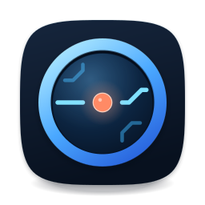
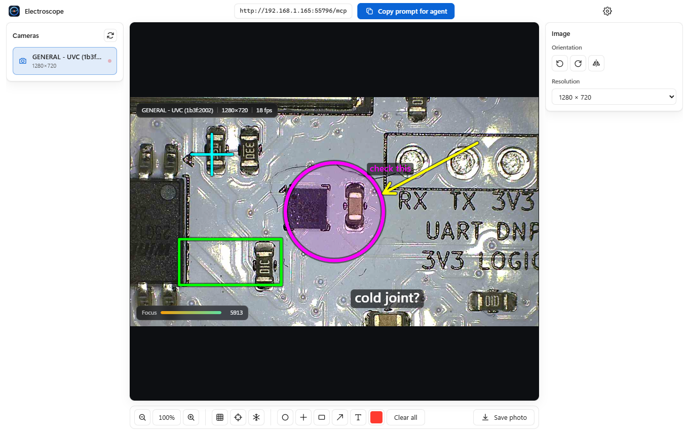

# Electroscope

<p align="center"></p>

A microscope camera as an MCP server. You watch the live view in a native window; any AI agent on your network can look through the same camera, zoom, focus, and draw on the picture.

A camera can usually be opened by one app at a time, so you cannot watch the microscope and also hand a stream to an agent. Electroscope owns the camera, shows it to you, and gives agents still frames and full control over MCP, without interrupting your view.



## Use it

Run the app. The title bar shows the address it serves on, for example `http://192.168.1.165:7821/mcp`. Click **Copy prompt for agent** and paste it into Claude Code, Codex, or any agent. The prompt has the IP, the port, how to connect, and every tool.

Or connect directly:

```bash
claude mcp add --transport http electroscope http://<ip>:7821/mcp
```

Then ask: "Look at the board and circle anything that looks like a solder bridge."

## What an agent can do

- **Look**: `capture_snapshot` (full frame or a full-resolution close-up of any region, or exactly what you have zoomed to), `capture_sequence` for things that change, with focus, brightness and exposure metrics and plain-language hints.
- **Point**: `annotate` draws circles, crosshairs, rectangles, arrows and text in any colour on your live view. Marks stay on their feature when you zoom. `clear_annotations` removes them.
- **Control**: `set_camera_controls` (focus, zoom, exposure and so on, only where the camera really obeys), `set_orientation`, `set_view` (zoom, pan, grid and crosshair with colours, freeze), `select_camera`, `list_cameras`, `save_photo`.

Full reference: [docs/mcp.md](docs/mcp.md).

## What you can do in the window

Zoom and pan, grid and crosshair overlays, freeze, rotate and mirror, pick a resolution, save a full-resolution photo, and draw your own circles, crosshairs, rectangles, arrows and text in a colour you pick. **Clear all** removes every mark; Ctrl+Z removes the last one. A live sharpness meter helps you find best focus.

Camera sliders appear only for controls the camera actually obeys. Many inexpensive UVC cameras accept brightness, contrast and sharpness settings and ignore them; Electroscope tests each control when the camera opens and hides the ones that do nothing.

## Security

The server has no password. It listens on your network by default so agents on other computers can reach it, which means anyone who can reach the port can look through the camera and control it. Use it on a network you trust, or turn off **Let other computers on the network connect** in Settings to listen on this computer only. Requests that name any host other than an IP address or this computer's own name are refused, which blocks DNS-rebinding attacks from web pages.

On Windows, the first run shows a firewall prompt; allow it on private networks for other computers to connect.

## Install

Windows 11 and macOS. Download a build from the releases page, or run from source:

```bash
git clone https://github.com/UnlikeOtherAI/Electroscope.git
cd Electroscope
npm install
npm start
```

Build a package:

```bash
npm run dist:win    # Windows installer and portable exe, in release/
npm run dist:mac    # macOS dmg and zip, in release/ (run on a Mac)
```

If the app says the camera is busy, another program has it. Close the Camera app, Teams, or a browser tab using the camera; Electroscope keeps retrying and connects as soon as it is free.

## Develop

```bash
npm run typecheck
npm test                      # unit tests: tools, transport safety, addresses, prompt, annotations
npm run test:e2e              # launches the app and drives it over MCP with your real camera
node scripts/e2e.mjs --fake   # same, with Chromium's synthetic camera (what CI runs)
npm run icons                 # re-render build/icon.* from build/icon.svg
```

The end-to-end script drives the real app as an agent would, checks that marks land on the right pixels, and writes screenshots and every captured image to `test-output/`.

- `src/main`: Electron main process and the MCP server (`mcp/tools.ts` defines the tools, `mcp/http.ts` is the Streamable HTTP transport).
- `src/renderer`: the window. It owns the camera, draws the live view and marks, and answers requests from the main process.
- `src/shared`: types, IPC channel names, and the agent prompt.

## License

[MIT](LICENSE)
