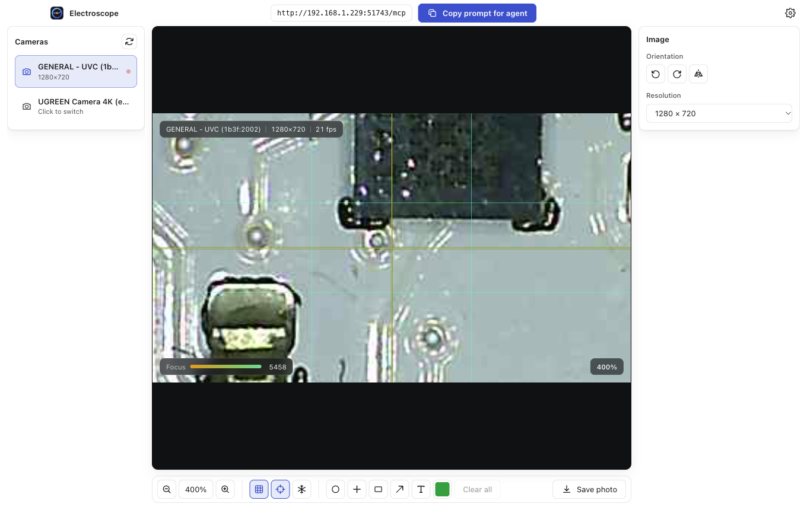

<p align="center"></p>

<h1 align="center">Electroscope</h1>
<p align="center"><strong>Give Claude, Codex, and other agents eyes on your electronics.</strong></p>
<p align="center">See the same board. Point to the same pin. Work through the next measurement together.</p>

<p align="center">
  <a href="https://github.com/UnlikeOtherAI/Electroscope/releases/latest/download/Electroscope-Windows-x64-Setup.exe"></a>
  <a href="https://github.com/UnlikeOtherAI/Electroscope/releases/latest/download/Electroscope-macOS-arm64.dmg"></a>
</p>
<p align="center">
  <a href="https://github.com/UnlikeOtherAI/Electroscope/releases/latest/download/Electroscope-Windows-x64-Portable.exe">Windows portable</a> ·
  <a href="https://github.com/UnlikeOtherAI/Electroscope/releases/latest/download/Electroscope-macOS-arm64.zip">Mac ZIP</a> ·
  <a href="https://github.com/UnlikeOtherAI/Electroscope/releases">All releases</a>
</p>
<p align="center">Windows 11 x64 · macOS on Apple Silicon · Free and open source</p>

Electroscope connects your USB microscope to an agent that supports **MCP**, including Claude Code and Codex. You keep a live view of the board while the agent takes snapshots, inspects close-ups, and draws marks on the picture.

Instead of “the little component on the left,” your agent can circle the component, put a crosshair on a test point, or draw an arrow to the pin it wants you to probe. You can draw back to show exactly where you measured. You handle the probes and measurements; Electroscope makes the visual conversation precise.


*Example marks on a real microscope image. Both you and the agent can add annotations to the same view.*

## A second pair of eyes at your bench

- **Inspect together.** Ask the agent to look at solder joints, read visible markings, or compare a detail before and after rework.
- **Make the next probe location clear.** Circles, arrows, crosshairs, boxes, and text turn “measure here” into a specific place on the board.
- **Keep the detail.** The agent can request a full-resolution crop, follow your zoomed view, or take a sequence of stills.
- **Stay in control.** Zoom, pan, rotate, mirror, freeze, add a grid, draw your own marks, and save photos while the camera stays open.
- **Work across your bench.** Run the microscope on one computer and connect an agent from another computer on the same trusted network.



*Zoom into the detail you are discussing. The agent can capture that same region without losing the original camera pixels.*

## Get started

1. **Install Electroscope** using a download above. On Mac, open the DMG and drag Electroscope into Applications. On Windows, run the installer or use the portable app.
2. **Plug in your USB microscope** and open Electroscope. Allow camera access and select the microscope in the camera list.
3. **Click “Copy prompt for agent.”** Paste it into Claude Code, Codex, or another MCP-capable agent. It contains your camera server’s address, connection instructions, and available tools.
4. **Start looking at the board together.** Ask for a fresh image, describe the fault, and share your measurements as you go.

Try a prompt like:

> Look at this board. Circle any solder joints worth inspecting more closely, and explain what you see.

> Mark the pin you mean before I put the probe on it.

> I measured 3.3 V at the point I marked. Take another look and suggest the next measurement.

Your agent’s own service or subscription still applies; Electroscope needs no account. It shares still images on request while you watch the live camera view.

## Connect your agent

**Copy prompt for agent** is the quickest way to get the correct address. For Claude Code, you can also add the server directly:

```sh
claude mcp add --transport http electroscope http://<microscope-computer-ip>:7821/mcp
```

For Codex or another MCP client, add the **Streamable HTTP MCP URL** shown in Electroscope’s title bar. Use the displayed URL: the port can change if the default is busy.

Agents can take snapshots and sequences, annotate the image, adjust the on-screen view, choose a camera, save photos, and change hardware controls where the camera supports them. [Read the full tool reference →](docs/mcp.md)

## Your camera, your network

Electroscope serves the camera from your computer. Network access is on by default and has no password, so use it on a trusted network. To keep access on the same computer, turn off **Let other computers on the network connect** in Settings.

If another app has the microscope open, close that app; Electroscope retries automatically. Camera sliders appear only for controls the camera actually responds to. Use the microscope’s physical focus ring when it has no software focus control.

## Contribute

Want to build from source, report a problem, or improve a tool? See the [development guide](docs/development.md), [release workflow](docs/releases.md), or [open an issue](https://github.com/UnlikeOtherAI/Electroscope/issues).

Made by [UnlikeOtherAI](https://unlikeotherai.com). [MIT licensed](LICENSE).
